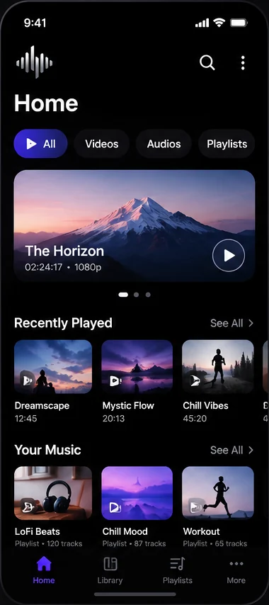
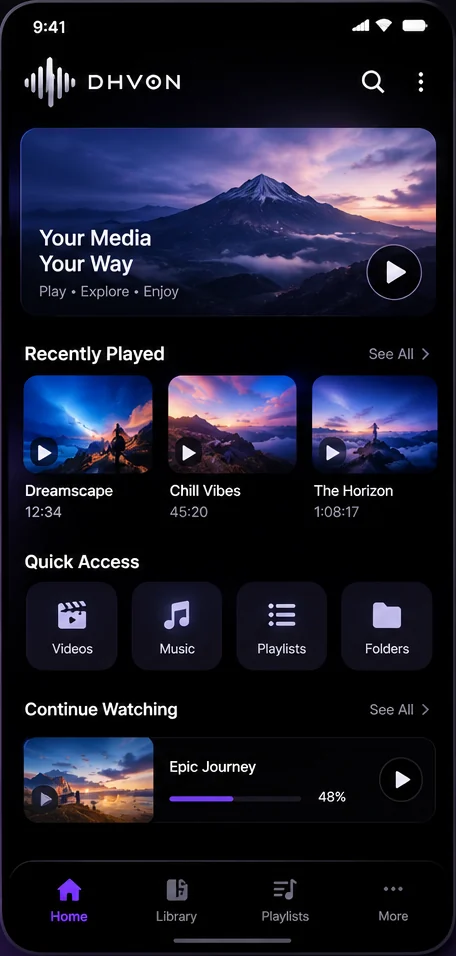
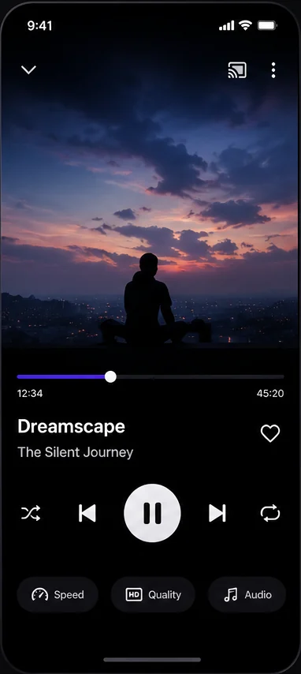
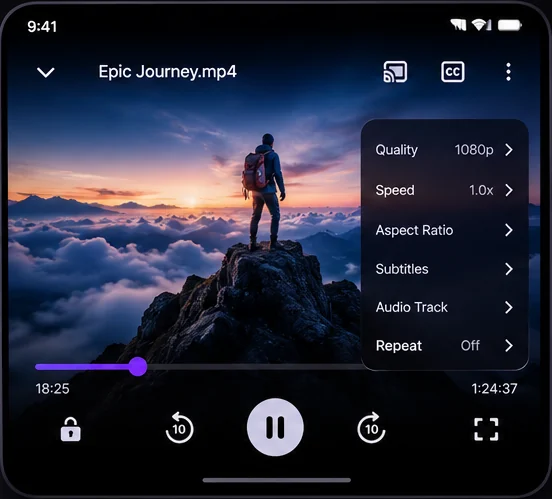
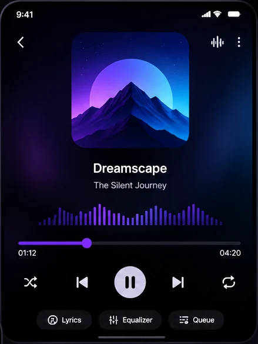
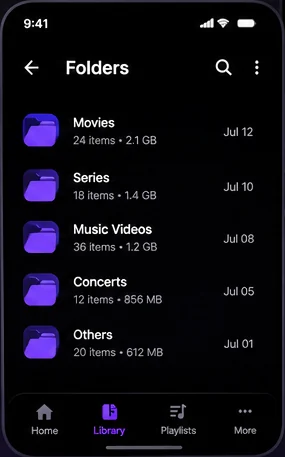
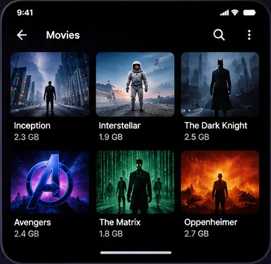

<div align="center">


# DHVON

**Every Sound. Every Frame.**

An offline-first, ad-free video and music player for Android.<br>
The gestures of a pro player. The calm of a Now Playing screen.

[**Website**](https://rhshourav.github.io/dhvon/) · [**Download APK**](https://github.com/rhshourav/dhvon/releases/latest) · [**Report a bug**](https://github.com/rhshourav/dhvon/issues)

<br>

&nbsp;
&nbsp;


</div>

---

## Why DHVON

- **Offline-first.** Your library is already on your phone. Playing it never needs the internet.
- **Ad-free.** No banners, no interruptions.
- **Private by design.** Media is read through MediaStore and the system picker (SAF). It does not request `MANAGE_EXTERNAL_STORAGE`.
- **Plays nearly everything.** Media3 with FFmpeg extensions for `.mkv` `.ts` `.avi` `.mp4` `.flv` `.webm` `.mp3` `.flac` `.aac` `.ac3` `.eac3` `.dts` `.opus` `.wav`.

## Features

### Pro video player

<div align="center">

</div>

| Gesture | What it does |
|---|---|
| Double-tap left / right | Skip ±10 s with a running counter (`+10s`, `+20s`, `+30s`) |
| Slide across the screen | Seek with a live timestamp and delta, with keyframe snapping for smooth `.mkv` / `.ts` scrubbing |
| Swipe left edge | Brightness, 0–100% |
| Swipe right edge | Volume, up to 150% |
| Pinch | Fit, Fill, Stretch, 100% or custom zoom |
| Screen lock | Ignores all touch until you unlock |

The quick-settings menu covers decoder mode (**HW**, **HW+**, **SW** via FFmpeg), playback speed from 0.25x to 4.0x, aspect ratio, subtitle tracks with ±0.1 s sync, audio tracks, background audio and Picture-in-Picture.

### Music and audio

<div align="center">

</div>

- Now Playing with an animated waveform scrubber
- Synced `.lrc` lyrics
- Equalizer with Bass Boost, Virtualizer and presets: Flat, Bass Boost, Vocal, Cinema, Custom
- Queue, Play Next, Loop One, Loop All and Shuffle
- Sleep Timer: after a set time or at the end of the track

### Library and folders

<div align="center">
&nbsp;&nbsp;

</div>

- Indexed MediaStore queries for fast folder browsing
- Grid and list views
- Sort by name, date, size or duration
- In-folder search and last-opened-folder quick jump
- Batch select to add to a playlist, move, rename, share or delete
- Internal storage and SD card capacity bar

### Themes

Obsidian (`#08090D`), Pure AMOLED Black, Light and Material You (dynamic color).

## Tech stack

| Area | Choice |
|---|---|
| Language and UI | Kotlin 2.x, Jetpack Compose, Material 3, Navigation Compose |
| Architecture | MVVM + Clean Architecture, Hilt, Coroutines and Flow |
| Playback | AndroidX Media3 (ExoPlayer, MediaSession, Compose UI), Jellyfin FFmpeg decoder |
| Storage | Room, DataStore Preferences |
| Images | Coil 3 |
| Build | Gradle Kotlin DSL with a version catalog |

## Build from source

```bash
git clone https://github.com/rhshourav/dhvon
cd dhvon
./gradlew assembleRelease
```

## Website

The project site lives in [`docs/`](docs) and deploys to GitHub Pages through [`.github/workflows/pages.yml`](.github/workflows/pages.yml). It redeploys on every push, every published release and every 6 hours, and it picks up the newest APK automatically.

## Credits

Designed and built by [**rhshourav**](https://github.com/rhshourav).

<div align="center">

**Every Sound. Every Frame.**

</div>
