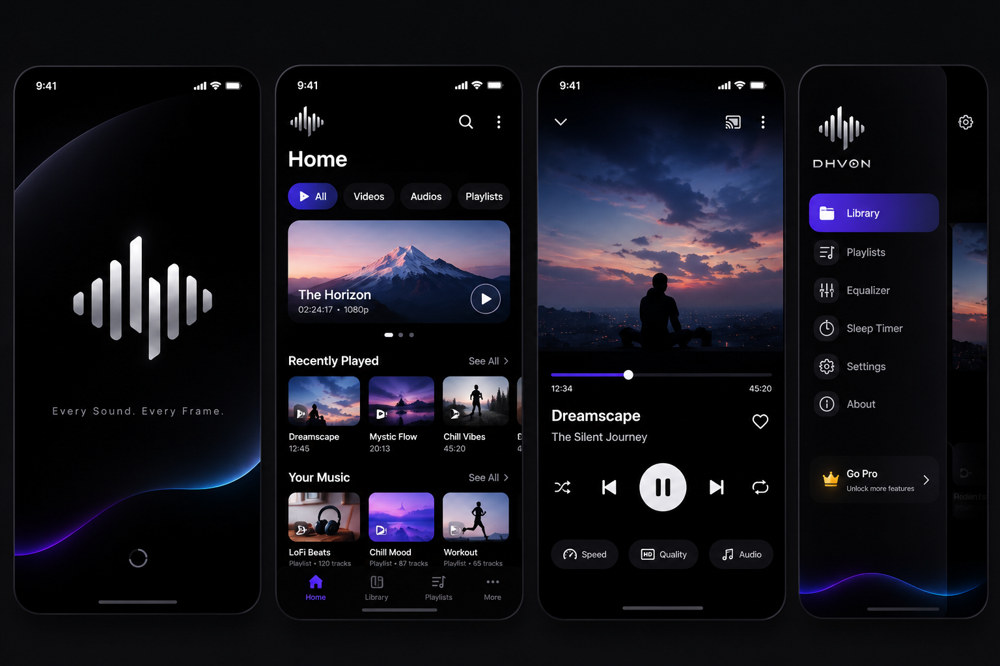
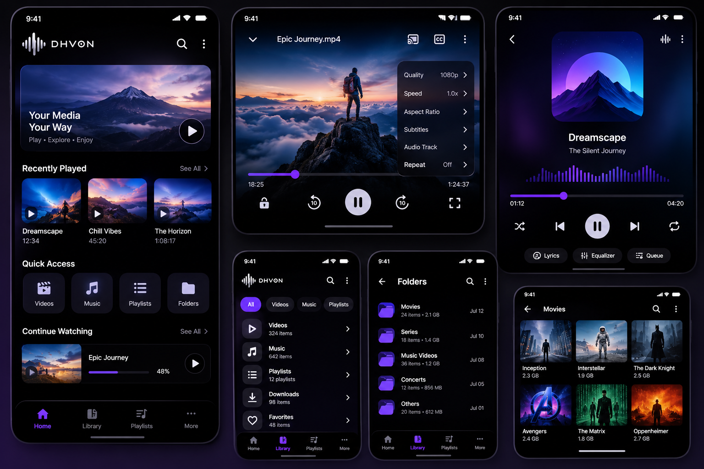

<p align="center">
  
</p>

<h1 align="center">DHVON</h1>
<p align="center"><b>Every Sound. Every Frame.</b><br/>
An offline-first, ad-free, premium video + audio player for Android.</p>

<p align="center"><b>Version 3.0.1</b> — see the <a href="CHANGELOG.md">changelog</a></p>

<p align="center">
  Created by <a href="https://github.com/rhshourav"><b>rhshourav</b></a> ·
  <a href="https://github.com/rhshourav/DHVON">github.com/rhshourav/DHVON</a> ·
  GPL-3.0-or-later
</p>

---

DHVON merges an Apple-style minimal, OLED-first interface and fluid *Now Playing* experience with the pro-grade
controls of MX Player: gesture seeking, hardware / software decoding, subtitle sync and fast folder management.
No ads, no accounts, no network permission — it only plays what is already on your device.

| | |
|---|---|
|  |  |

## Features

**Navigation** — bottom bar (Home · Folders · Playlists · More) plus a sticky round DHVON button on the right: tap it to play — or jump back into — whatever you played last.

**Library & folders** — indexed `MediaStore` scan (fast), live updates, SAF fallback for SD cards / unindexed folders,
smart folder categories (Movies · Series · Music Videos · Concerts · Downloads · Others), storage capacity bar,
last-opened-folder quick jump, **per-folder memory of the file you were playing last** (highlighted, scrolled to, and offered as “Continue where you left off”), a dedicated **Folders** tab with the storage bar pinned at the bottom, grid / list views, sort by name / date / size / duration, in-folder search, and batch
multi-select → add to playlist · share · rename · move · delete (through Android's own consent dialogs —
**no `MANAGE_EXTERNAL_STORAGE`**).

**Pro video player** — double-tap ±10 s with a cumulative counter · horizontal slide-to-seek with a
`18:25 [+01:12]` overlay and keyframe-snapping modes (exact / closest / previous) for lag-free `.mkv` / `.ts` scrubbing ·
left-edge brightness, right-edge volume (0–150 %) · pinch zoom + pan · aspect modes (Fit, Crop, Stretch, 16:9, 4:3, 100 %) ·
screen lock · previous / next · **Background play**, **Audio mode**, Pop-up and a **Playlist** panel (slides up from the bottom) in the top bar · one-tap **Background play** and **Audio mode** (the screen transforms into an audio player: artwork, waveform, full transport, video renderer asleep) · centered brightness/volume bars · **edge buffer** so Android's back-swipe never seeks · Picture-in-Picture · glass quick-settings menu (decoder HW / HW+ / SW, speed 0.25–4×,
subtitles + sync + styling, audio tracks + delay, play mode, repeat).

**Music** — Now Playing with ambient colour extraction from the artwork, a waveform scrubber built from the *real* decoded
audio peaks that pulses with the live output level, favorites, synced `.lrc` lyrics, queue with drag-and-drop reorder,
5/10-band equalizer (whatever the device exposes) + bass boost + virtualizer + presets, sleep timer (minutes or end of track).

**Background play, hardened** — media notification + lock-screen controls, foreground media service, audio-mode hand-off, audio focus / noisy-output handling, wake lock, skip-over-missing-files, and the last queue + position are checkpointed so DHVON can restore it (paused) after Android kills the app. A Settings shortcut opens the battery-optimisation list for phones that are aggressive about it.

**Playlists** — mixed audio/video playlists, drag-to-reorder, Play Next, Add to Queue, Shuffle, Loop One, Loop All.

**Make it yours** (Settings → UI & Gesture Settings) — theme (Obsidian / AMOLED / Light / Material You), accent colour (expanding picker: presets, colour square, hue bar, hex), text size, compact density, **progress-bar style** (video: Line or Flat · music: Waveform, Flat or Line, with live
preview), show/hide each Home section (hero, recently played, folders, quick access, continue watching), per-gesture on/off
switches, gesture sensitivity, double-tap skip length, seek precision, controls auto-hide delay, remaining-time display,
subtitle size/colour/background, and a one-tap *Reset all customisation*.

## Tech

Kotlin 2.3 · Jetpack Compose (Material 3) · Navigation Compose · Hilt · Room · DataStore · Coil 3 ·
AndroidX Media3 (ExoPlayer + MediaSession) · Jellyfin FFmpeg decoder for Media3 · Gradle Kotlin DSL + version catalog.
MVVM with `data` / `domain` / `ui` / `player` layers. Exact versions: [`gradle/libs.versions.toml`](gradle/libs.versions.toml).

```
app/src/main/java/com/rhshourav/dhvon
├── DhvonApp.kt · MainActivity.kt · VideoPlayerActivity.kt
├── di/            Hilt module (Room, DataStore, app scope)
├── domain/        MediaFile, MediaFolder, formatting helpers
├── data/
│   ├── local/     Room: resume positions, favorites, playlists, folder history
│   ├── settings/  DataStore preferences (theme, gestures, decoder, EQ…)
│   ├── media/     MediaRepository (MediaStore + SAF + scoped file ops), artwork, waveform, subtitle & LRC parsers
│   └── user/      UserDataRepository
├── player/        PlayerHolder (decoder modes), DhvonPlaybackService (MediaSession), DhvonAudioProcessor
│                  (audio delay + level meter), AudioEffectsController, SleepTimer, PlaybackController
└── ui/            theme · components · nav · screens (Home, Library, Folder, Playlists, Now Playing, Video, …)
```

## Build

1. Android Studio (current stable) with **JDK 17** and **Android SDK Platform 37**.
2. `git clone https://github.com/rhshourav/DHVON.git` → open the folder → *Sync* → Run.
   CLI: `./gradlew :app:assembleDebug`.

> **Keep `media3` and `jellyfinFfmpeg` in `gradle/libs.versions.toml` on the same release.** The FFmpeg decoder is compiled
> against one exact Media3 version (currently 1.9.0 / `1.9.0+1`). Bump them together.

## Honest notes & known limits

- **Not compiled by its author's tooling yet.** The project was generated without access to the Android SDK. It has been
  statically reviewed for imports and API use, and `.github/workflows/android.yml` builds it on every push — treat the
  first CI run as the real test and expect a handful of small compile fixes, mostly from API drift.
- **License.** The bundled FFmpeg decoder is GPL-3.0, so DHVON as a whole is GPL-3.0-or-later and its source must be
  available to anyone you distribute it to. That is compatible with selling it, not with closing the source.
- **Audio delay is positive-only** (0–3000 ms): a delay line can push sound *later*, not earlier.
- **Subtitle sync:** external `.srt / .ass / .vtt` files support ±10 s; *embedded* tracks support delay only (a cue can't be
  shown before the decoder produces it).
- **"Software" decoding** means software MediaCodec video decoders + FFmpeg audio. The Jellyfin extension is audio-only.
- **Pop-up window** is Android Picture-in-Picture (system resizable window), not a draw-over-apps overlay.
- **Cast** is not included (it needs the Google Cast SDK / Play Services).
- Rename / move need Android 11+ (they rely on `createWriteRequest`); files from SAF folders can't be moved.
- `.lrc` lyrics are attached by picking the file once per track (scoped storage can't read sibling files).

## Credits

**DHVON** — design, concept and ownership: **[rhshourav](https://github.com/rhshourav)**.
Built on AndroidX Media3 / ExoPlayer, the Jellyfin FFmpeg decoder for Media3, Jetpack Compose, Hilt, Room, Coil and
[Calvin Reorderable](https://github.com/Calvin-LL/Reorderable). See [`LICENSE`](LICENSE).

---
<p align="center"><i>© 2026 rhshourav — Every Sound. Every Frame.</i></p>
